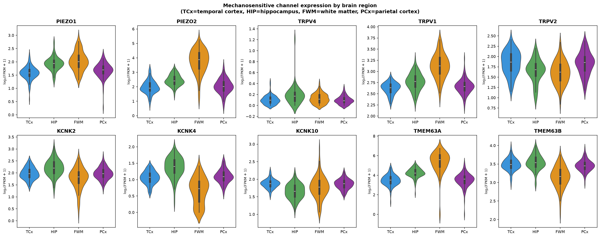
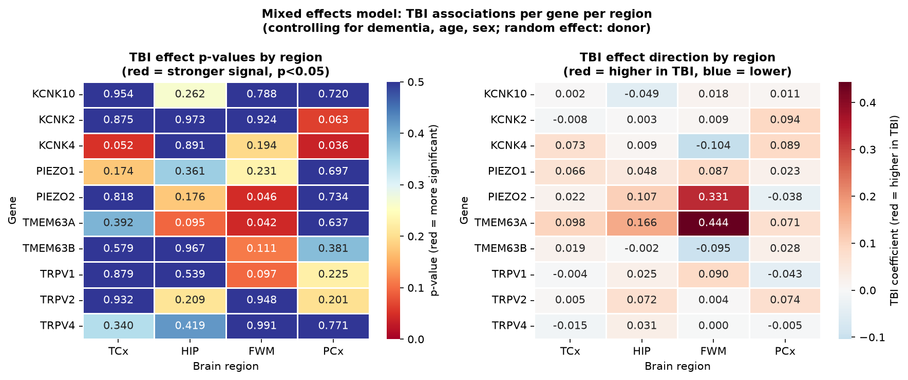
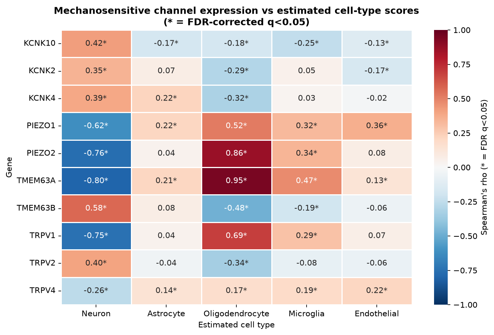

# Mechanosensitive ion channels in the ageing human brain after traumatic brain injury

An exploratory bioinformatics analysis of mechanosensitive ion channel gene expression in post-mortem human brain tissue from older adults with and without a history of traumatic brain injury (TBI).

## Background

Traumatic brain injury is fundamentally a mechanical event. Forces stretch and shear brain tissue, and cells detect these forces through mechanosensitive ion channels. These are membrane proteins that open in response to physical deformation and convert it into electrical and chemical signals. Channels such as PIEZO1, PIEZO2, TRPV4, TMEM63A and B, and the TREK and TRAAK potassium channels (KCNK2, KCNK10 and KCNK4) are found across neurons, astrocytes, microglia, oligodendrocytes and vascular cells. Their role in the long-term consequences of TBI, including neuroinflammation and neurodegeneration, is poorly understood, particularly in human tissue. TBI is also an established risk factor for dementia, so understanding how mechanosensing relates to the injury and to Alzheimer's-type pathology is a translational interest.

## Dataset

This project uses the Allen Institute **Aging, Dementia and TBI Study** (aging.brain-map.org), a public dataset from the Adult Changes in Thought (ACT) cohort. After quality control it contains RNA-seq data from 107 post-mortem donors, of whom 53 had a history of TBI with loss of consciousness and 54 had no reported TBI. There are 377 tissue samples from four regions (hippocampus, temporal neocortex, parietal neocortex and forebrain white matter), alongside donor metadata, immunohistochemistry pathology scores, and Luminex measurements of tau, amyloid and inflammatory proteins.

## Research questions

1. Is expression of mechanosensitive channel genes different between donors with and without a history of TBI?
2. Does expression differ across brain regions, particularly in white matter, which is vulnerable to the shear forces of injury?
3. Does expression differ with dementia status after accounting for TBI, age and sex?
4. Does channel expression correlate with tau, amyloid, astrocyte and microglia markers, or inflammatory proteins?
5. Which cell types do the channels appear to be associated with, based on marker gene scores?

## Methods

All analysis was done in Python (pandas, statsmodels, scipy, seaborn).

- **Genes:** Ten channel genes were analysed (PIEZO1, PIEZO2, TRPV1, TRPV2, TRPV4, KCNK2, KCNK4, KCNK10, TMEM63A and TMEM63B). Pseudogenes were excluded.
- **Expression data:** Allen's normalised FPKM values, adjusted for batch and RNA quality, were transformed as log2(FPKM + 1).
- **Mixed effects models:** Each gene was modelled as `expression ~ TBI + dementia + age + sex` with donor as a random intercept, because each donor contributed up to four regions. Models were fitted on all samples and separately within each brain region. Banded ages (for example 90-94) were converted to midpoints.
- **Correlations:** Spearman rank correlations were calculated between expression and 15 pathology and protein measures. Isoprostane was excluded because 63% of values were missing. Pairwise complete observations were used otherwise.
- **Cell-type scores:** Scores were calculated as the mean log2 expression of four published marker genes per cell type (Zhang et al. 2016) for neurons, astrocytes, oligodendrocytes, microglia and endothelial cells, then correlated with channel expression.
- **Multiple testing:** Benjamini-Hochberg false discovery rate (FDR) correction was applied within each family of tests (10 pooled models, 40 region-specific models, 160 pathology correlations and 50 cell-type correlations). Results are reported as q-values.

## Key findings

**1. All ten channels are expressed in aged human brain tissue.** TRPV4 is expressed at very low levels (FPKM below 1.3) and should be interpreted with caution [`figures/01_expression_distributions.png`](figures/01_expression_distributions.png)

**2. Expression differs more by brain region than by TBI.** PIEZO2, TRPV1 and TMEM63A are markedly higher in white matter than in the three grey matter regions (`figures/02_expression_by_region.png`). [](figures/02_expression_by_region.png)

**3. No association with TBI or dementia survived multiple testing correction.** In pooled models every q-value was above 0.88. In region-specific models the largest nominal effects were higher TMEM63A (coefficient 0.44 log2 units, p = 0.042) and PIEZO2 (0.33, p = 0.046) in white matter of TBI donors, but all q-values were above 0.5. These are treated as hypotheses for follow-up and not as findings (`figures/03_mixed_model_heatmap.png`). [](figures/03_mixed_model_heatmap.png)

**4. Channel expression correlates with pathology and glial markers across the cohort.** For example TMEM63A (ρ = 0.46) and PIEZO2 (ρ = 0.42) correlate positively with GFAP staining, and TMEM63A correlates negatively with amyloid staining (ρ = -0.29) ([correlation heatmap](figures/04_correlation_heatmap.png) and [top correlation scatter plots](figures/04_top_correlations_scatter.png)). Correlations run separately in TBI and no-TBI donors were similar in direction and size for most pairs.

**5. Channels separate into two groups by estimated cell-type association.** TMEM63A, PIEZO2, TRPV1 and PIEZO1 track oligodendrocyte marker scores (ρ = 0.95, 0.86, 0.69 and 0.52) and show negative correlations with neuron scores. The potassium channels, TMEM63B and TRPV2 track neuron scores (`figures/05_cell_type_scores.png`). Because white matter is rich in oligodendrocytes and poor in neurons, this pattern largely reflects the white versus grey matter difference and does not by itself show which cell type expresses each channel. [](figures/05_cell_type_scores.png)


## Limitations

- **Small sample.** With 107 donors, the analysis can only detect large effects, and so the lack of significant TBI results should not be read as evidence of no effect.
- **Long post-injury interval.** TBI occurred years to decades before death, so the data reflect long-term differences and not the acute response or healing.
- **Self-reported exposure.** TBI history was self-reported and mostly reflects single injuries. The control group may include unrecorded injuries and many controls have dementia.
- **Bulk tissue.** Cell types are mixed in each sample. Marker-based scores are rough proxies and not true deconvolution.
- **Regional confounding.** Cell composition and pathology differ strongly between regions, so pooled correlations in Notebooks 4 and 5 may partly reflect region. Within-region analyses are a planned next step.
- **Non-independence.** Correlations treated all samples as independent despite several samples per donor, so their q-values are likely too optimistic. The mixed models in Notebook 3 account for donor.
- **RNA is not protein.** Transcript levels do not equal channel protein abundance or function.
- **Association, not causation.** All results are exploratory.

## Repository structure

```
notebooks/
  01_download_and_qc.ipynb                  data loading, cohort description and QC
  02_channel_expression.ipynb               expression by TBI status and brain region
  03_mixed_models.ipynb                     mixed effects models, pooled and by region
  04_correlations_proteins_pathology.ipynb  correlations with pathology and inflammation
  05_cell_type_scores.ipynb                 marker-based cell-type scores
figures/                                    output figures
data/                                       download instructions only, no raw data
environment.yml                             conda environment
```

## How to reproduce

1. Clone this repository.
2. Create the environment with `conda env create -f environment.yml` and activate it with `conda activate tbi-channels`.
3. Download the RNA-seq and metadata files from [aging.brain-map.org/download/index](https://aging.brain-map.org/download/index) and place them in `data/`. Raw data are not included, in line with the Allen Institute terms of use.
4. Run notebooks 01 to 05 in order.

## Next steps

- Repeat the correlations and cell-type analysis within each brain region.
- Formally test whether channel and pathology relationships differ between TBI and no-TBI donors.
- Validate in a larger cohort or in single-cell data.

## References

- Allen Institute for Brain Science. Aging, Dementia and TBI Study. aging.brain-map.org
- Miller JA et al. (2017). Neuropathological and transcriptomic characteristics of the aged brain. *eLife* 6, e31588.
- Zhang Y et al. (2016). Purification and characterization of progenitor and mature human astrocytes reveals transcriptional and functional differences with mouse. *Neuron* 89(1), 37-53.
